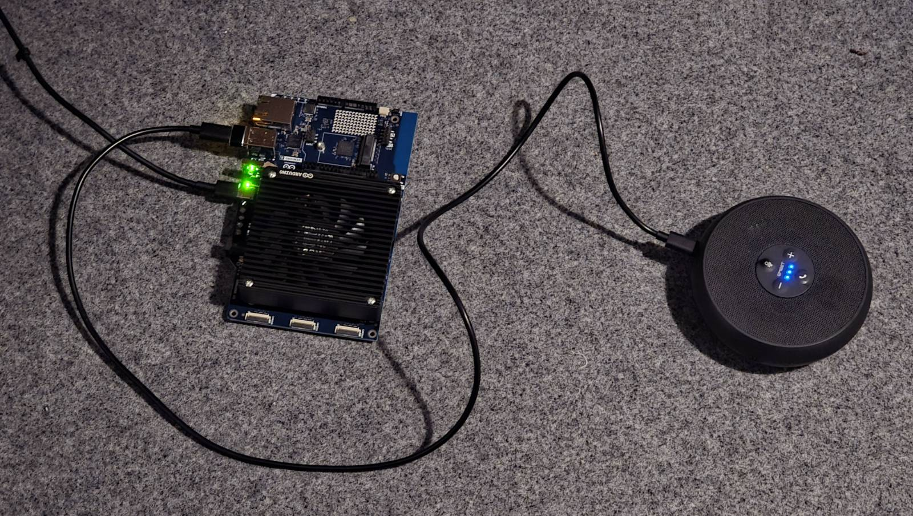
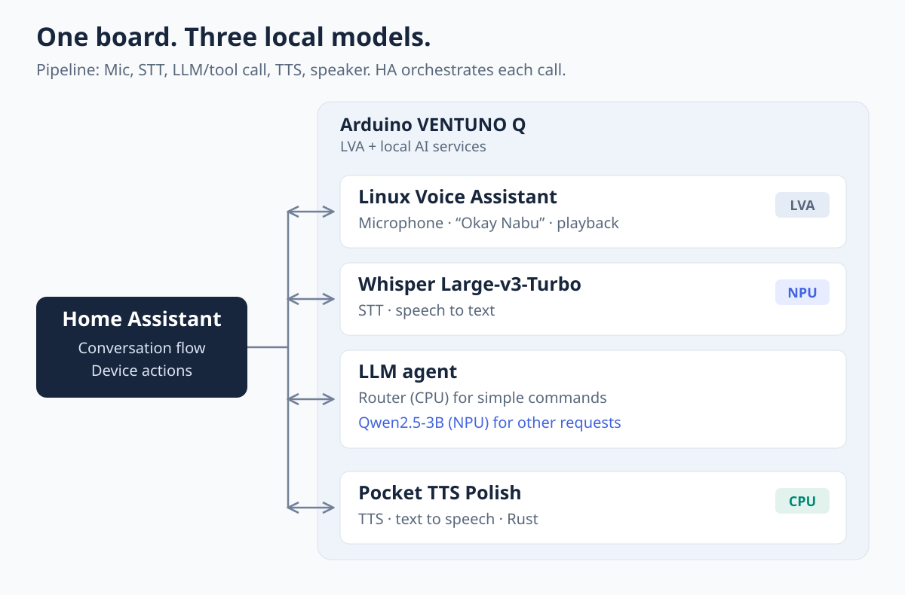
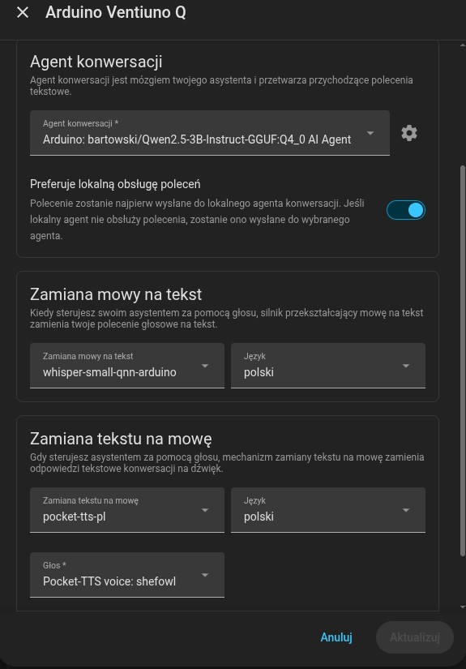

<p align="center">
  
</p>

# Domuno

**A local, Polish-first voice assistant for Home Assistant on Arduino VENTUNO Q.**

Domuno was built for Polish first, but it is multilingual: English and Spanish
show how the same stack can support other languages. Choose one language per
installation with `AGENT_LANGUAGE` (`pl`, `en`, or `es`).

The name joins *dom* (home) with *Ventuno*, the board the assistant runs on.
Whisper, Qwen2.5 and Pocket TTS run on one small board. Home Assistant keeps the
conversation, the device catalog and the actual device control. The core voice stack
needs no cloud inference or cloud API keys. Optional web search and weather use external APIs.

## Changelog

**Unreleased (`meteo_brave`):** Optional Brave web search and Open-Meteo weather.
Qwen chooses when to use them; the gateway runs them without an extra Home
Assistant round trip. See [setup and Arduino smoke tests](docs/local-tools.md).

<p align="center">
  
</p>

<p align="center">
  <a href="LICENSE"></a>
  
  
</p>

## What this is

This repository is the glue between Home Assistant and the local AI runtimes on
Arduino VENTUNO Q:

| Stage | Model | Runs on |
| --- | --- | --- |
| Speech to text | Whisper Large-v3-Turbo W8A16 | Hexagon NPU |
| Conversation and tool calls | Qwen2.5-3B-Instruct Q4_0 via GenieX | Hexagon NPU |
| Text to speech | Pocket TTS (`pl`, `en`, `es`) | CPU |
| Wake word, microphone, playback | Linux Voice Assistant 1.1.18 | CPU / USB audio |

Home Assistant orchestrates the pipeline: it sends audio to STT, sends the text to
the OpenAI-compatible gateway, executes the returned tool calls, and sends the
answer to TTS. The gateway only *proposes* tool calls. It never touches a device.

## How it works

<p align="center">
  
</p>

1. LVA detects “Okay Nabu” and streams the recording to Home Assistant.
2. HA calls Whisper through Wyoming and gets the transcript.
3. HA sends the transcript, the exposed entities and the tool schemas to the
   gateway. The router handles a few simple commands locally; everything else
   goes to Qwen with the original request.
4. HA executes the returned tool call. If HA starts another round, the gateway
   forwards the tool result back to the model.
5. HA sends the final sentence to Pocket TTS; LVA plays the audio.

### Why a command router?

The NPU makes a small local model practical, but processing the Home Assistant
context and generating a tool call still takes time. For a simple command like
“turn on the kitchen light,” parsing the transcript and matching it against the
entity catalog is faster than asking the model to work out the same action.

Home Assistant already has built-in sentence matching. In our testing it was
not reliable enough for some everyday Polish commands, particularly when users
inflected device or room names. Domuno adds a narrow router for those cases:
it can match forms such as *lampę* to *Lampa*, and leaves commands outside its
grammar to the model. Home Assistant still decides which entities are exposed
and executes the action.

The router handles on/off for lights, switches, fans and input booleans,
open/close for covers, and absolute cover positions. It can refuse a recognized
negation locally; conditions, multiple actions and unsupported parameters go to
the LLM. Details:
[docs/router.md](docs/router.md).

The gateway never caches answers and never replays actions. It may reuse a token
prefix through GenieX; that is a runtime optimization, not an application cache.

## Tested configuration

| Component | Version / model |
| --- | --- |
| Board | Arduino VENTUNO Q, Qualcomm Dragonwing IQ-8275, 16 GB RAM |
| Host | Ubuntu ARM64 with Qualcomm NPU drivers and QAIRT 2.50 HTP libraries |
| LLM runtime | GenieX CLI **0.11.0** (0.9.3 only with `CACHE_POLICY=reset`) |
| LLM | `bartowski/Qwen2.5-3B-Instruct-GGUF:Q4_0` |
| STT | Whisper Large-v3-Turbo W8A16, ONNX Runtime 1.30.0 + `onnxruntime-qnn` 2.6.0 |
| TTS | `shefowl/pocket-tts-polish-6l` with the Rust ARM64 runtime |
| Satellite | Linux Voice Assistant 1.1.18, wake word `okay_nabu` |
| HA integration | [Local OpenAI LLM](https://github.com/skye-harris/hass_local_openai_llm) 1.15.1 via HACS |
| Audio | USB conference speaker (microphone and speaker in one device) |

## Measurements on the test board

| Measurement | Result |
| --- | --- |
| Whisper Turbo: 2.83 s of speech | **~0.43 s** transcription |
| [Pocket TTS: first PCM over Wyoming](docs/performance.md#pocket-tts) | Median **0.22–0.60 s** across three Polish inputs (five warm runs per input) |
| Router path, no LLM | **~0.9 ms** decision; **~2.6 ms** including gateway handling |
| LLM fixed-sentence test, 3550-token context | median **9.97 s** |
| KV cache, first request (empty prefix) | prefill **6823 ms**; total **7035 ms** |
| KV cache, cached request | prefill **153 ms**; total **294 ms** (3156 tokens reused) |
| Cold cache: first real HA request | total **~9.30 s**; prefill **7.31 s** |
| Warm cache: next real HA request | total **~3.73 s**; prefill **0.16 s** |
| Warm cache: LLM tool call | total **~3.86 s**; prefill **0.16 s** |

Measurements from one test board. **Cold** means an empty
KV prefix with Qwen already loaded; **warm** means the prefix was reused. Cold
boot, including model loading, takes 12–15 s. Details:
[docs/performance.md](docs/performance.md).

## Requirements

The repository does **not** ship the board's Linux image, Qualcomm drivers or
model weights. You need:

| Dependency | How to get it |
| --- | --- |
| Arduino VENTUNO Q with Ubuntu ARM64 and NPU drivers | Board system image / BSP |
| QAIRT 2.50 HTP libraries (`libQnnHtp.so`) | Board image or GenieX installation |
| Docker Engine + Compose plugin | Board image or [Docker docs](https://docs.docker.com/engine/install/ubuntu/) |
| Python 3.10+, `git`, `curl`, `libatomic1`, `libglib2.0-0` | Ubuntu packages |
| [`uv`](https://docs.astral.sh/uv/) | Official installer |
| GenieX 0.11.0 | [Vendor instructions](https://geniex.aihub.qualcomm.com/en/run/cli/install) |
| Home Assistant + HACS + Local OpenAI LLM | Separate HA instance on the LAN |
| PulseAudio or PipeWire-Pulse user session | Existing board user session |

Home Assistant and its integrations are configured separately. The scripts check
the host prerequisites; they do not replace drivers or install another audio
server.

## Quick start

### 1. Prepare the board

```bash
sudo apt update
sudo apt install -y curl git python3 libatomic1 libglib2.0-0
curl -LsSf https://astral.sh/uv/install.sh -o /tmp/install-uv.sh
sh /tmp/install-uv.sh
export PATH="$HOME/.local/bin:$PATH"
```

Install GenieX 0.11.0 using the vendor instructions. On a prepared board image:

```bash
curl -fsSL https://qaihub-public-assets.s3.us-west-2.amazonaws.com/qai-hub-geniex/install.sh \
  -o /tmp/install-geniex.sh
sh /tmp/install-geniex.sh --version v0.11.0
geniex --skip-update --version   # expect 0.11.0
docker ps
systemctl --user show-environment
```

The drivers must come from the board's system image/BSP. Installing GenieX alone
does not install the NPU drivers.

### 2. Clone and configure

```bash
git clone https://github.com/p4vv37/domuno.git
cd domuno
cp .env.example .env
chmod 600 .env
```

Set at least:

| Variable | Value |
| --- | --- |
| `GGUF` | Full path to the Qwen Q4_0 file reported by `geniex pull` |
| `QNN_LIB_DIR` | Directory containing `libQnnHtp.so` |
| `LVA_USER_ID`, `LVA_USER_GROUP` | `id -u`, `id -g` |
| `AUDIO_INPUT_DEVICE`, `AUDIO_OUTPUT_DEVICE` | Your microphone and speaker |

Set `AGENT_LANGUAGE` (`pl`, `en` or `es`), then download the tokenizer and
the selected local speech assets:

```bash
./run.sh prepare
```

`prepare` downloads models without running inference. It skips any speech stage
set to `external`.

### 3. Check and start

```bash
./run.sh check
./run.sh start
./run.sh status
```

`check` prints `OK` or `MISSING` for tools, model files, NPU devices, HTP
libraries, the audio socket, the prompt counter and the GenieX version. `start`
refuses to continue while anything required is missing.

The stack starts in this order: the prompt counter (when it is local), Qwen
(one guarded cold load and a short control inference), Whisper, the gateway,
then Pocket TTS and LVA. The gateway warms up the router before binding its port;
systemd marks it ready only after that.

### 4. Add the integrations in Home Assistant

Home Assistant needs three integrations:

| Purpose | Integration | Where it comes from |
| --- | --- | --- |
| STT and TTS | **Wyoming Protocol** | Built into Home Assistant |
| LVA satellite | **ESPHome** | Built into Home Assistant |
| Conversation and tools | **Local OpenAI LLM** | Custom integration via HACS |

Only the conversation agent needs HACS. It must support a custom
OpenAI-compatible `/v1/chat/completions` endpoint, tool schemas and streamed
responses. The official **OpenAI** integration only supports the official OpenAI
endpoint, and **Ollama** expects an Ollama server. The tested integration is
[Local OpenAI LLM](https://github.com/skye-harris/hass_local_openai_llm) 1.15.1;
another generic OpenAI-compatible integration may work, but is not tested.

1. Install [HACS](https://hacs.xyz/docs/use/) if needed. In HACS → Integrations →
   three-dot menu → **Custom repositories**, add
   `https://github.com/skye-harris/hass_local_openai_llm` as **Integration**,
   download it and restart HA.
2. Settings → Devices & services → **Add Integration** → **Local OpenAI LLM**.
   Server URL: `http://<Arduino-IP>:18191/v1`; API key: empty unless
   `GATEWAY_API_KEY` is set; server type: `llama.cpp`; model:
   `bartowski/Qwen2.5-3B-Instruct-GGUF:Q4_0`. Enable **Device control** tools.
3. Add **Wyoming Protocol** for `<Arduino-IP>:10301` (STT) and
   `<Arduino-IP>:10201` (TTS).
4. Add **ESPHome** for `<Arduino-IP>:6053`; do not prefix it with `http://`.
5. Create an Assist pipeline matching `AGENT_LANGUAGE` with the Local OpenAI
   agent, Whisper STT and the matching Pocket TTS voice (`shefowl` for Polish,
   `alba` for English, `lola` for Spanish). Enable **Prefer local intents** and
   assign the assistant to the LVA satellite.
6. Expose only the entities you want to control. The **Device control** tool sees
   only exposed entities, and a smaller list means a smaller prompt.

The LVA satellite keeps its own **Okay Nabu** wake word; HA handles the pipeline
after the wake word. The screenshots below show the tested configuration:

<p align="center">
  
</p>

Full walkthrough, including the HACS screens, agent options and alternatives:
[docs/home-assistant.md](docs/home-assistant.md).

## Daily use

```bash
./run.sh status
./run.sh stop
./run.sh start
./run.sh stats
journalctl --user -u qwen-ha-gateway -n 30 --no-pager
docker logs --tail 30 linux-voice-assistant
```

To let user services start without logging in:

```bash
sudo loginctl enable-linger "$USER"
```

After a manual full stop, the boot guard blocks another Qwen cold load within the
same boot. Reboot the board instead of deleting the guard file.

## Configuration

The defaults are in [`.env.example`](.env.example). The most important
values:

| Variable | Default | Meaning |
| --- | --- | --- |
| `GGUF` | — | Qwen Q4_0 GGUF path |
| `QNN_LIB_DIR` | — | QAIRT 2.50 HTP library directory |
| `NCTX` | `10240` | Model context size |
| `AGENT_LANGUAGE` | `pl` | Router, local Whisper and local Pocket TTS language: `pl`, `en` or `es` |
| `STT_PROVIDER` | `whisper-qnn` | `whisper-qnn` or `external` |
| `STT_PROMPT` | empty | Optional decoder prompt; empty means no prompt |
| `TTS_PROVIDER` | `pocket` | `pocket` or `external`; `pocket-pl` is a legacy alias |
| `CACHE_POLICY` | `reuse` | `reuse` on GenieX 0.11.0; `reset` for 0.9.3 |
| `RESPONSE_STYLE` | `concise` | Short voice answers; `original` for A/B |
| `DECIDE_APPLY` | `1` | Let the router answer recognized commands |
| `GATEWAY_API_KEY` | empty | Optional bearer token |

Every variable, including diagnostics and advanced installer settings, is
documented in [docs/configuration.md](docs/configuration.md).

The gateway always needs a **prompt counter**. With `GGUF` + `TOKENIZER` the
installer creates a local CPU counter; otherwise set `COUNTER_URL` to an existing
loopback counter. The gateway refuses to start without it.

`AGENT_LANGUAGE` selects one language for the router, local Whisper decoding
and local Pocket TTS per deployment. `TTS_PROVIDER=external` is optional for
any language. It does not install or select a voice for you; configure the
matching integration in Home Assistant. See the [Assist setup](docs/home-assistant.md#4-create-the-assist-pipeline)
and [speech migration checks](docs/operations.md#speech-migration-checks).

The local Pocket TTS bridge accepts complete text and streams PCM audio. It
handles one synthesis at a time; overlapping requests receive `busy`.

## Limitations

- **Qwen2.5-3B is small.** It handles short commands and tool selection well, but
  it is not a multi-step planner. Complex requests can produce invented arguments.
- **Full context is expensive.** A large HA catalog plus tool schemas can take
  about 20 s of prefill. Exposing fewer entities and keeping the KV prefix stable
  matter more than prompt wording.
- **Speech coverage.** Local Pocket TTS synthesis was verified on VENTUNO Q
  for Polish, English and Spanish.
- **One NPU is shared.** Whisper and Qwen must not cold-load at the same time.
  There is no CPU fallback. FastRPC out-of-memory requires a reboot, not a retry.
- **One tested board image.** Other ARM64 boards, QAIRT versions or GenieX
  releases are unverified. Replacing the LLM or STT artifact is a separate
  compatibility exercise.
- **Not a Home Assistant add-on.** HA and the board are separate services on the
  LAN. The gateway is not hardened for the public Internet.

## Troubleshooting

| Symptom | First thing to check |
| --- | --- |
| `./run.sh check` prints `MISSING` | Fix the named item; `check` never installs anything |
| Gateway will not start: `prompt counter is required` | Set `GGUF` + `TOKENIZER`, or `COUNTER_URL` |
| Qwen will not load, or FastRPC `ENOMEM` | Stop Whisper, reboot; the guard allows one load per boot |
| HA cannot reach STT/LLM/TTS | `curl` the gateway `/healthz`; check ports and `GATEWAY_HOST` |
| Gateway returns 413 / 503 | 413: fewer entities or smaller prompt. 503: counter is down |
| No sound or no waiting cue | `docker logs tts-pocket-pl`; `./run.sh sound-test` |
| A simple command goes to the LLM | Expected fail-open: ambiguous target or unsupported grammar |

More detail, log locations and safe reporting: [docs/troubleshooting.md](docs/troubleshooting.md).

## Privacy and security

- Inference is local. The repository does not send prompts, audio or transcripts
  to a cloud service.
- The gateway listens on the LAN and is **unauthenticated by default**, matching
  the local-only design. Set `GATEWAY_API_KEY` in `.env` and in HA if your
  network is not trusted. Never port-forward it to the Internet.
- Audio is not saved. Raw requests, router transcripts and request captures are
  off by default or explicitly opt-in, stored under `logs/` with private
  permissions, and ignored by git. They contain home and conversation data: keep
  them local.
- The default metrics records contain no prompts, entity names, transcripts or
  tool arguments. They are diagnostic timing data, not anonymous telemetry. A
  metadata-only cache audit is on by default; set `CONTEXT_AUDIT=0` to disable it.
- The HA integration is third-party. Review it before exposing sensitive
  entities.

## Development

See [CONTRIBUTING.md](CONTRIBUTING.md) for the test command, repository layout,
reading order and review process. To step through `decide()` on a PC, use
[docs/debugging-router.md](docs/debugging-router.md).

### How to add a router language

Start with a vocabulary: list the synonymous words or phrases that map to each
router intent (`close`, `open`, `on`, `off`, and optionally `position`). Add the
spoken success message and clarifications. These keys describe router intents,
not Home Assistant tool names. Here is the bundled [Polish example](gateway/languages/pl/vocabulary.json):

```json
{
  "commands": {
    "close": ["zamknij", "zamknijcie", "zamykaj", "zamknąć", "zasłoń", "zasuń"],
    "open": ["otwórz", "otwórzcie", "otwieraj", "otworzyć", "odsłoń", "odsuń"],
    "on": ["włącz", "włączcie", "zapal", "zaświeć", "uruchom"],
    "off": ["wyłącz", "wyłączcie", "zgaś"],
    "position": ["ustaw"]
  },
  "responses": {
    "success": "Wykonano",
    "default_clarification": "Nie mogę jednoznacznie wykonać tego polecenia.",
    "clarifications": {
      "negation": "OK, nie wykonuję tej akcji.",
      "catalog-unavailable": "Nie mam teraz listy urządzeń.",
      "no-target": "Nie znalazłem takiego urządzenia. Podaj dokładniejszą nazwę.",
      "ambiguous-area": "Urządzenie ma kilka obszarów. Doprecyzuj jego nazwę w HA.",
      "missing-area": "W którym pomieszczeniu mam to zrobić?",
      "area-mismatch": "Nie ma takiego urządzenia w tym pomieszczeniu.",
      "ambiguous-target": "Jest kilka pasujących urządzeń. Podaj dokładniejszą nazwę.",
      "invalid-position": "Podaj pozycję jako pełny procent od zera do stu.",
      "position-unavailable": "Nie mam zgodnego narzędzia do ustawienia pozycji tego urządzenia."
    }
  }
}
```

- **Customize Polish or English:** copy the bundled vocabulary, edit the synonyms
  or replies, set `ROUTER_VOCABULARY` to the copied file in `.env`, and restart
  the gateway. Use the complete file, not a partial override.
- **Add a new language in code:** create `gateway/languages/<code>/` with a
  `vocabulary.json`, a bundled `grammar.json` (see the [Polish example](gateway/languages/pl/grammar.json)),
  and a `Strategy` in `__init__.py` inheriting the shared
  [`Language` interface](gateway/languages/base.py). Define `code` and
  `vocabulary_path`. The default `parse()` uses the bundled rules; override it
  only if the language needs a different parsing algorithm. Register the language once in the [language registry](gateway/languages/__init__.py);
  the gateway, launcher and installer check the same registry. Add tests for
  natural commands and phrases that must not trigger actions. Configure STT/TTS
  separately; adding a router language does not add a speech recipe.

See the [router guide](docs/router.md) for vocabulary validation and fallback behavior.

## Documentation

- [Configuration](docs/configuration.md) — every `.env` variable and how to apply it
- [Operations](docs/operations.md) — startup, KV cache, updates, metrics, private logs
- [Router](docs/router.md) — grammar, vocabulary, fallback and cover positions
- [Debugging the router](docs/debugging-router.md) — synthetic harness, VS Code and PyCharm
- [Home Assistant](docs/home-assistant.md) — integrations, HACS, Assist pipeline and screenshots
- [Performance](docs/performance.md) — measured numbers and caveats
- [Troubleshooting](docs/troubleshooting.md) — common failures and safe diagnostics

## Credits

This project stands on other people's work:

- [Home Assistant](https://www.home-assistant.io/) — conversation pipeline and device control
- [Linux Voice Assistant](https://github.com/OHF-Voice/linux-voice-assistant) — satellite and wake word
- [GenieX](https://geniex.aihub.qualcomm.com/) and [Qwen2.5](https://huggingface.co/Qwen/Qwen2.5-3B-Instruct) — local LLM runtime and model
- [Whisper Large-v3-Turbo](https://huggingface.co/openai/whisper-large-v3-turbo) and [Qualcomm AI Hub](https://aihub.qualcomm.com/) — STT artifact
- [Pocket TTS](https://github.com/kyutai-labs/pocket-tts) and [`shefowl/pocket-tts-polish-6l`](https://huggingface.co/shefowl/pocket-tts-polish-6l) — TTS model and Rust runtime
- [Wyoming](https://github.com/OHF-Voice/wyoming) — protocol and Python library used by the independent TTS bridge
- [Local OpenAI LLM](https://github.com/skye-harris/hass_local_openai_llm) — HA integration
- [simplemma](https://github.com/adbar/simplemma), [polish-inflection](https://pypi.org/project/polish-inflection/), [num2words](https://github.com/savoirfairelinux/num2words) — router linguistics

The build and measurements are described in the article
[Local voice assistant on Arduino VENTUNO Q](https://pkowalski.com/arduino-local-agent/)
(in Polish).

## License

Domuno's own code is MIT; see [LICENSE](LICENSE). Third-party software, models
and recordings retain their own licenses. For the Pocket TTS build, see the
[pinned sources and license notices](tts-pocket-wyoming/THIRD_PARTY_NOTICES.md).

This is an independent project, not affiliated with Arduino, Qualcomm, Home
Assistant or the Qwen project. Product names belong to their respective owners.
