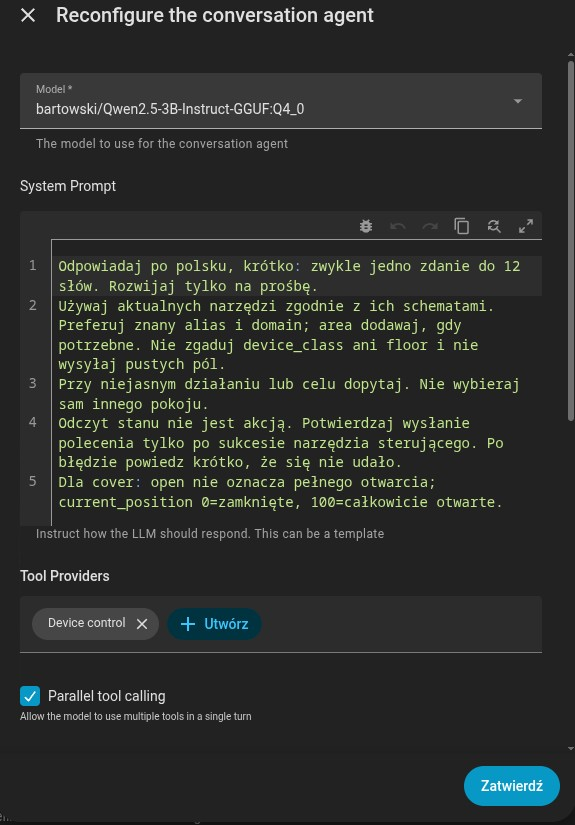
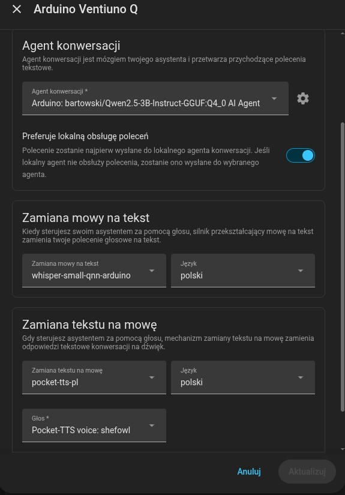
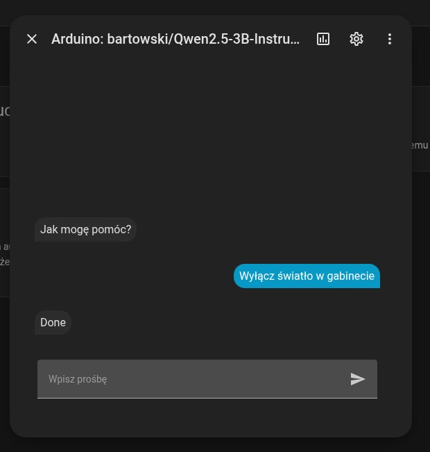

# Home Assistant setup

The board exposes four things to Home Assistant:

| Purpose | Service | Port |
| --- | --- | --- |
| Speech to text | Whisper Large-v3-Turbo | `10301` |
| Text to speech | Pocket TTS (`pl`, `en`, `es`) | `10201` |
| Conversation and tool calls | OpenAI-compatible gateway | `18191` |
| Voice satellite | Linux Voice Assistant (ESPHome API) | `6053` |

Home Assistant needs three integrations. Two are built in; only the conversation
agent needs HACS.

| Purpose | Integration | Where it comes from |
| --- | --- | --- |
| STT and TTS | **Wyoming Protocol** | Built into Home Assistant |
| LVA satellite | **ESPHome** | Built into Home Assistant |
| Conversation + tools | **Local OpenAI LLM** | Custom integration via HACS |

The conversation integration is the one that usually needs a third-party component. It must:

- talk to an OpenAI-compatible **Chat Completions** endpoint (`/v1/chat/completions`),
- send the HA tool schemas and the `role: tool` results,
- support the gateway's streamed chat responses (independent of TTS text input),
- let you set a custom server URL and leave the API key empty.

The official **OpenAI** integration does not support third-party endpoints, and
the **Ollama** integration expects the Ollama API. The tested integration is
[Local OpenAI LLM](https://github.com/skye-harris/hass_local_openai_llm) 1.15.1.
Another generic OpenAI-compatible integration may work, but it is not tested; see
[Alternatives](#alternatives).

## 1. Install the conversation integration

HACS is only needed for this integration. Wyoming and ESPHome are already part of
Home Assistant.

1. Install [HACS](https://hacs.xyz/docs/use/) if it is not installed, and restart
   Home Assistant.
2. Open **HACS → Integrations**.
3. Open the three-dot menu → **Custom repositories**.
4. Add `https://github.com/skye-harris/hass_local_openai_llm`, category
   **Integration**.
5. Search for **Local OpenAI LLM**, download it, and restart Home Assistant.
6. Go to **Settings → Devices & services → Add Integration** and select
   **Local OpenAI LLM**.

If you prefer not to use HACS, the integration's
[README](https://github.com/skye-harris/hass_local_openai_llm#installation) also
documents a manual install into `custom_components/local_openai`.

### Configure the server

Use these values:

| Field | Value |
| --- | --- |
| Server URL | `http://<Arduino-IP>:18191/v1` |
| API key | Empty, unless `GATEWAY_API_KEY` is set in `.env`; then the same token |
| Server type | `llama.cpp` (the tested option; the gateway speaks the same OpenAI shape) |
| Model | `bartowski/Qwen2.5-3B-Instruct-GGUF:Q4_0`, or your `MODEL` value |

The URL must end with `/v1`. The model id must match what the gateway exposes;
you can check it with:

```bash
curl http://<Arduino-IP>:18191/v1/models
```

Then open the conversation agent options:

- Enable the **Device control** tool provider. This is what lets the model call
  HA actions.
- If your version also offers a broad **Home Assistant** tool provider, do not
  enable it for a voice satellite. It grants administrator access and is not
  needed for normal commands.
- **Parallel tool calling** is optional. The test setup had it enabled, but a 3B
  model is usually more reliable with one tool call at a time. Disable it if you
  see malformed or duplicated tool calls.
- A system prompt is optional. The gateway already adds a short-answer style
  instruction, so do not duplicate the same rules in both places.

<p align="center">
  
</p>

## 2. Add Wyoming STT and TTS

The Wyoming integration is built in. Add it once for each service:

1. **Settings → Devices & services → Add Integration → Wyoming Protocol**.
2. Enter the board host and the service port.
3. Repeat for the second service.

| Service | Host | Port |
| --- | --- | --- |
| Whisper STT | `<Arduino-IP>` | `10301` |
| Pocket TTS | `<Arduino-IP>` | `10201` |

Home Assistant may discover them automatically. If it does not, add them
manually with the host and port above. The STT integration may still be named
`whisper-small-qnn-arduino` for compatibility; the loaded artifact is the
Large-v3-Turbo model.

Whisper and Pocket TTS each advertise one language per instance. Match the
Assist pipeline to `AGENT_LANGUAGE` and select the voice in Assist, not in the
Wyoming integration:

| `AGENT_LANGUAGE` | Pocket TTS voice | Locale |
| --- | --- | --- |
| `pl` | `shefowl` | `pl-PL` |
| `en` | `alba` | `en-US` |
| `es` | `lola` | `es-ES` |

After an upgrade or language change, reload the Wyoming integrations to refresh
advertised languages and voices, then reselect the voice if needed. The Polish
voice advertises `pl-PL`, not `pl`. The bridge accepts complete text only and
streams PCM audio back; overlapping requests receive `busy`. Local TTS was
verified on VENTUNO Q for all three languages, but the full English and Spanish
Assist pipelines have not yet been tested end to end.

## 3. Add the LVA satellite

LVA exposes an ESPHome-compatible API on `6053`.

1. **Settings → Devices & services → Add Integration → ESPHome**.
2. Enter `<Arduino-IP>` and port `6053`.
3. Do not prefix the host with `http://`.
4. Leave the Noise PSK empty unless you configured encryption in LVA.

If mDNS works on your network, HA may discover the satellite automatically. You
can also add it by host and port.

## 4. Create the Assist pipeline

1. Go to **Settings → Voice assistants → Add assistant**.
2. Set the language to match `AGENT_LANGUAGE`: **Polish**, **English**, or **Spanish**.
3. Select the conversation agent you created above.
4. Select the Whisper STT entity.
5. Select the Pocket TTS entity and the matching voice (`shefowl`, `alba`, or
   `lola` respectively).
6. Enable **Prefer local intents** so HA handles simple commands before sending
   them to the LLM.
7. Assign this assistant to the LVA satellite. The exact label depends on the
   LVA/ESPHome version; it is usually on the satellite device page.

<p align="center">
  
</p>

### Spanish example

Edit the existing settings in `.env`:

```dotenv
AGENT_LANGUAGE=es
STT_PROVIDER=whisper-qnn
STT_PROMPT=""
TTS_PROVIDER=pocket
```

1. [Prepare the Spanish Pocket TTS assets](configuration.md#preparing-local-pocket-tts),
   then start the stack, or follow the
   [speech migration steps](operations.md#speech-migration-checks) for an existing deployment.
2. Add or refresh the Whisper and Pocket TTS Wyoming integrations on ports
   `10301` and `10201`, respectively.
3. In **Settings → Voice assistants**, select **Spanish**, the Domuno conversation
   agent, Whisper for STT, and Pocket TTS with voice `lola` (`es-ES`). Try
   “Enciende la luz de la cocina” if the kitchen light is exposed to Assist.

### Expose only the entities you need

Go to **Settings → Voice assistants → Expose** and expose the entities or areas
you want to control. The **Device control** tool only sees exposed entities.
Fewer entities mean a smaller prompt, less prefill work and fewer wrong targets.

Do not expose locks or alarms until you have tested the pipeline; the router
does not handle those domains, so they go to the LLM. Test sensitive covers
separately before exposing them.

## 5. Test it

1. Ask a neutral question, for example “Opowiedz krótko, jak działa ten asystent.”
2. Then try a simple command such as “Włącz światło w kuchni.”
3. Finally try a command the router should handle locally, such as
   “Zamknij roletę w salonie.”

A local command returns a short confirmation without an LLM round trip. A
question or a complex command goes to Qwen. If the assistant answers but does
not execute anything, check the **Device control** tool provider and the exposed
entities.

<p align="center">
  
</p>

## Alternatives

**Conversation agent.** The gateway exposes Chat Completions and `/v1/models`;
it does not implement the Responses API or embeddings. AI Tasks are untested. Any HA integration that:

- accepts a custom base URL,
- uses `/v1/chat/completions`,
- sends tool schemas and tool results,
- supports the model's streaming/tool-call format

could work in place of Local OpenAI LLM. The tested one is Local OpenAI LLM
1.15.1. The official OpenAI integration is not an option because it only supports
the official OpenAI endpoint. The Ollama integration is not an option because
the gateway is not an Ollama server.

**STT and TTS.** You can use any Home Assistant STT/TTS integration instead of the
local Wyoming services. Set `STT_PROVIDER=external` and/or
`TTS_PROVIDER=external`, choose the integration in the Assist pipeline, and make
sure its language matches the pipeline. Domuno does not install or configure
an external provider, which can be local (for example, Piper) or cloud-hosted.

**Satellite.** LVA is optional as a component: the gateway, STT and TTS can serve
any HA satellite or the HA app. If you use another satellite, skip the ESPHome
step and LVA compose file; the AI services and their ports stay the same.
