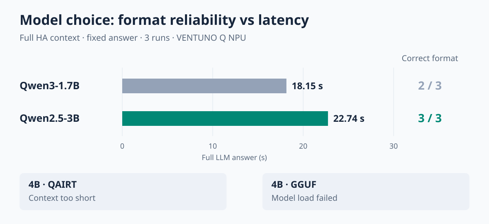
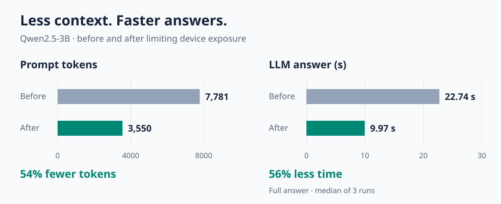
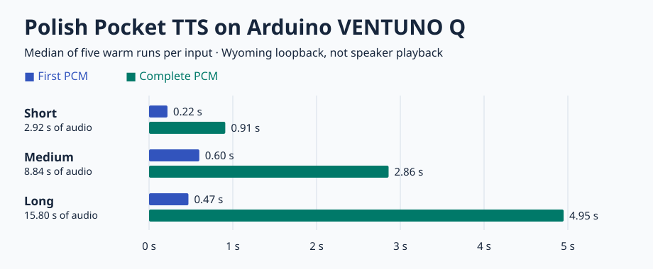

# Performance

These are measurements from one Arduino VENTUNO Q, not a benchmark suite or an
end-to-end latency guarantee. The model, context and KV-cache figures come from
the original GenieX 0.11.0 measurements. Pocket TTS was measured separately on the
board with the current bridge.

## Test setup

| Component | Build |
| --- | --- |
| Board | Arduino VENTUNO Q, Qualcomm Dragonwing IQ-8275, 16 GB RAM |
| NPU runtime | GenieX 0.11.0, QAIRT 2.50 HTP libraries |
| LLM | Qwen2.5-3B-Instruct Q4_0, `NCTX=10240` |
| STT | Whisper Large-v3-Turbo W8A16, ORT 1.30.0 + `onnxruntime-qnn` 2.6.0 |
| TTS | Pocket TTS Polish 6L, Kyutai Rust runtime v4.0.1 |
| Satellite | LVA 1.1.18, USB conference speaker, “Okay Nabu” |
| HA | Local OpenAI LLM 1.15.1, reduced entity exposure |

## Headline numbers

| Stage | Measurement | Result |
| --- | --- | --- |
| STT | 2.832 s of Polish speech | **~0.43 s** transcription |
| Router | One recognized command | **0.9 ms** decision; **2.6 ms** including gateway handling, no inference |
| LLM | Fixed-sentence test, 3550-token context | median **9.97 s** |
| LLM | No HA context, fixed sentence | ~1.8 s |
| LLM | Decode speed | ~14–15 tokens/s |

The LLM number is the complete answer time, not first token. Tool-call arguments
alone took about 2–3 s to generate even with a cache hit; a short user question
does not imply short model output when the model must emit a JSON function call.

## Why Qwen2.5-3B

The model had to understand Polish, call tools and leave resources for STT and
TTS. In a controlled three-run comparison, Qwen3-1.7B returned the requested
sentence form in 2 of 3 runs; Qwen2.5-3B returned it in 3 of 3. Qwen3-4B in the
QAIRT/QNN variant did not fit the full HA context, while the 4B GGUF variant failed
to load with a FastRPC memory-mapping error. Those are two different variants and
two different failures; neither produced a timing sample.



## Cold vs warm cache

Measured with GenieX 0.11.0 on 17.11.2026:

| Request | Input / cached | Prefill | Generation | Total | First token |
| --- | ---: | ---: | ---: | ---: | ---: |
| First real HA request (cold prefix) | 3346 / 3 | 7.308 s | 1.847 s | 9.304 s | 7.44 s |
| Next real HA request (warm prefix) | 3340 / 3323 | 0.155 s | 3.447 s | 3.725 s | 0.261 s |
| LLM tool call (warm prefix) | 3347 / 3322 | 0.161 s | 3.637 s | 3.862 s | — |

Different utterances and output lengths, so the totals are not directly
comparable. Prefill shows the cache effect; totals also include generation and
gateway overhead. Cold boot adds 12–15 s of model loading.

## Context size

Reducing the entities exposed to the model cut the prompt from 7781 to 3550
tokens. In a controlled fixed-sentence task, the median answer fell from 22.74 s
to 9.97 s, about 56%. The model, voice and question stayed the same.



## KV cache

GenieX 0.11.0 keeps the prompt prefix. On one synthetic 3164-token prompt with a
changed question, 3156 tokens were reused:

| Metric | Without reuse | With reuse |
| --- | ---: | ---: |
| Prefill | 6823 ms | 153 ms |
| Total request | 7035 ms | 294 ms |

This was a direct ARM64/NPU test, not an HA prompt, and a single observation. It
shows the mechanism, not a percentile guarantee.

The same effect on real HA requests is in
[Cold vs warm cache](#cold-vs-warm-cache): the first request needed 7.31 s of
prefill, while later requests reused over 3300 tokens and needed about 0.16 s.

Any change in the early prompt, another client on the same backend, or a backend
restart reduces reuse. `keepalive` keeps weights loaded; `cached_tokens` measures
prefix reuse. They are different.

## Pocket TTS

Measured 2026-11-24 on VENTUNO Q: ARM64 Docker build, Kyutai release v4.0.1
(`pocket-tts` binary 3.3.0), shefowl Polish 6L, quantized with one Rayon thread.
The container had no network access. A client inside it sent a complete Wyoming
`synthesize` request over loopback. Times run from submission to the first
nonempty `audio-chunk` and to `audio-stop`, respectively.

Medians of five requests per text after one warm-up:

| Polish text | Generated audio | First PCM | Complete PCM |
| --- | ---: | ---: | ---: |
| Short confirmation | 2.92 s | 0.22 s | 0.91 s |
| Three sentences with temperature and percentage | 8.84 s | 0.60 s | 2.86 s |
| Longer status summary | 15.80 s | 0.47 s | 4.95 s |



<details>
<summary>Benchmark inputs</summary>

- Short: `Światło w kuchni jest włączone.`
- Medium: `W gabinecie jest 21,5 °C. Jasność lampy ustawiono na 50%. Rolety w sypialni są otwarte.`
- Long: `Lampa w gabinecie jest włączona. Rolety w salonie są otwarte do połowy, a w sypialni są zamknięte. W kuchni jest 22 °C, a w gabinecie 19 °C. Wszystkie pozostałe światła są wyłączone.`

</details>

These are PCM delivery times, not HA or speaker latency. The bridge streams
PCM output, not text input. Cold model startup is not included in the table.

## Measuring a pipeline run

Export an Assist pipeline trace and summarize it without exposing the transcript:

```bash
python3 gateway/latency_stats.py --pipeline /tmp/assist-trace.json
```

`tts_url_ready_ms` measures URL availability only. `vad_end_to_run_end_ms` is not
speaker latency. Missing observations stay `null`.

If you observe first PCM and satellite playback for the same run, with
synchronized clocks, pass explicit timezone-aware timestamps:

```bash
python3 gateway/latency_stats.py --pipeline /tmp/assist-trace.json \
  --first-pcm-at '2026-11-17T12:00:06Z' \
  --playback-at '2026-11-17T12:00:07Z'
```

Use measured values, not the example. Service-local ids are not correlated with
HA runs automatically. `stt-vad-end` is the detected speech boundary, which can
lag the actual end of speech. The LVA image is external and is not instrumented
by this repository.

## What is not measured

- Physical speaker latency and perceived responsiveness.
- A percentile benchmark across many HA prompts or entity counts.
- Other boards, QAIRT versions, GenieX releases, models or voices.
- Long-running thermal throttling or 24/7 stability.
- The effect of every HA prompt change on native tokenization.

Use the gateway metrics to collect your own numbers with the same labels:

```dotenv
METRICS_BACKEND_VERSION=0.11.0
METRICS_PROFILE=qwen25-kv-reuse
```

Then:

```bash
./run.sh stats
python3 gateway/latency_stats.py --json logs/metrics/metrics.jsonl*
```

Keep the profile label honest when the model, context, tools or workload changes.
Small samples remain small samples.
